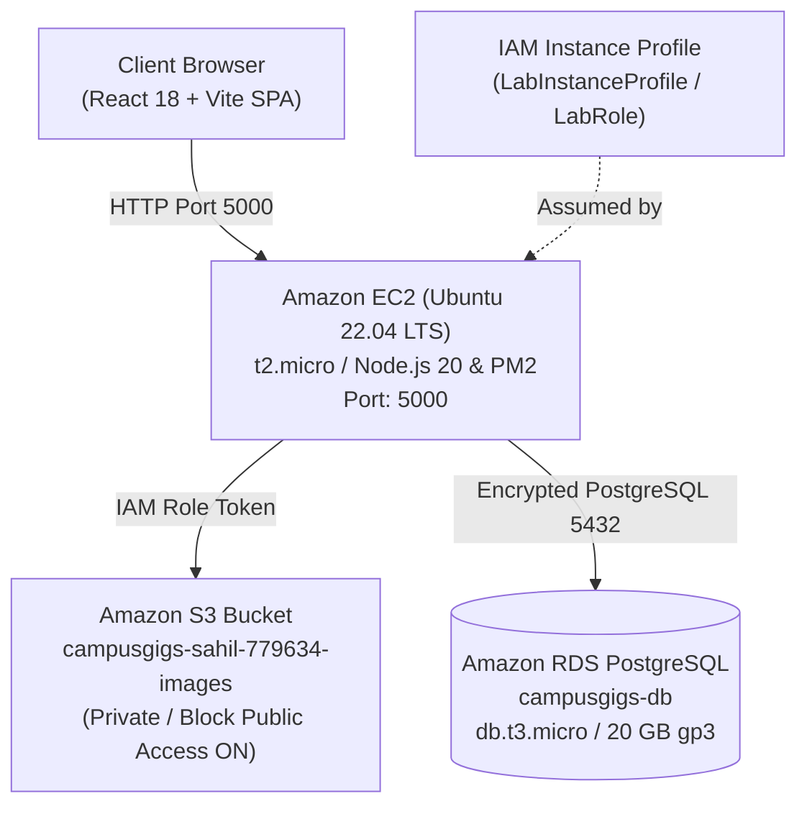

# CampusGigs - Cloud Computing Laboratory (CCL) Project Report
## AWS Cloud Infrastructure & Deployment Summary

**Student / Host:** Sahil Mirchandani  
**AWS Account ID:** 779634203533  
**Region:** `us-east-1` (US East - N. Virginia)  
**Date:** November 22, 2026  

---

## 1. System Architecture

The CampusGigs application is implemented as an enterprise-grade 3-tier cloud application on Amazon Web Services (AWS) using AWS Academy Learner Lab:



### Components & Cloud Configuration

| Service | Identifier | Configuration Details |
|---|---|---|
| **Compute** | Amazon EC2 | Instance Type: `t2.micro`, Ubuntu 22.04 LTS. Runs Node.js 20 & PM2 process manager. Attached to `LabInstanceProfile`. |
| **Relational Database** | Amazon RDS | Engine: PostgreSQL 16 on `db.t3.micro`. Storage: 20 GB gp3. DB Name: `campusgigs`. Endpoint: `campusgigs-db.cfvkhau6t7c1.us-east-1.rds.amazonaws.com:5432`. |
| **Object Storage** | Amazon S3 | Bucket Name: `campusgigs-sahil-779634-images`. Block Public Access: Enabled. Folders: `avatars/` and `gigs/`. Backend streams images via `/api/media/:folder/:file`. |
| **Security Groups** | `ec2-sg` (`sg-0a0ad8921460f7051`) | Inbound SSH (22) and Custom TCP (5000) from `0.0.0.0/0`. |
| | `rds-sg` (`sg-00b2f59c601ef04fe`) | Inbound PostgreSQL (5432) strictly authorized from `ec2-sg`. |
| **Identity & Security** | IAM | EC2 accesses S3 using `LabRole` instance profile without any hardcoded credentials. |

---

## 2. Verification & Test Flow Results

The end-to-end escrow and database flow test (`npm run test:flow`) was executed directly on the EC2 instance against Amazon RDS and Amazon S3.

### Test Output Log (All 42 checks passed):
```
ok    non-VES email rejected
ok    wrong login rejected
ok    register poster
ok    login poster
ok    register free1
ok    login free1
ok    register free2
ok    login free2
ok    poster starts with welcome coins
ok    post gig
ok    cannot bid on own gig
ok    bid above budget rejected
ok    two bids placed
ok    poster sees both bids
ok    non-owner cannot accept
ok    accept 400 bid
ok    poster balance 100, 400 locked
ok    cannot accept a second bid
ok    cannot confirm before delivery
ok    wrong freelancer cannot deliver
ok    deliver
ok    request revision
ok    re-deliver
ok    confirm releases 400
ok    no double release
ok    freelancer got 900 (500 bonus + 400)
ok    poster ends with 100, nothing locked
ok    freelancer XP 100 + 250 and 1 completed
ok    poster XP 100 + 50 + 100 and 1 posted
ok    bad UPI rejected
ok    cannot overdraw
ok    withdraw 300
ok    balance 600 after withdraw
ok    top up
ok    analytics has 14 / 8 / 6 buckets
ok    today bucket shows 400 earned
ok    history shows the completed gig
ok    freelancer leaves
ok    poster refunded 120
ok    gig reopened
ok    insufficient GigCoins blocked
ok    cancel open gig

All 42 checks passed.
```

### Health Check Response:
`GET /api/health`
```json
{
  "ok": true,
  "database": "connected",
  "storage": "s3"
}
```

---

## 3. Demo Accounts & Data (Seeded in RDS)

All accounts use the password: `demo1234`

* **`aarav@ves.ac.in`**: Full-Stack Student Developer (580 coins, 800 XP).
* **`meera@ves.ac.in`**: UI Designer (820 coins, 350 XP).
* **`rohan@ves.ac.in`**: Writer & Researcher (250 coins, 350 XP).
* **`sana@ves.ac.in`**: Video Editor & Producer.

---

## 4. Presentation & Session Management Guide

### For AWS Learner Lab:
1. In Learner Lab, sessions automatically expire after 4 hours.
2. Before your lab evaluation / presentation:
   - Click **Start Lab** in AWS Academy.
   - Wait for the green status light.
   - If EC2 or RDS was stopped, click **Start Instance** in the AWS EC2 and RDS consoles.
   - If the EC2 public IP changes, update `CLIENT_ORIGIN` in `server/.env` and run `pm2 restart campusgigs`.

### For Permanent 24/7 Deployment on Render:
- **Live Application URL**: [https://campusgigs-u70p.onrender.com](https://campusgigs-u70p.onrender.com)
- **Live Health Endpoint**: [https://campusgigs-u70p.onrender.com/api/health](https://campusgigs-u70p.onrender.com/api/health)
- **GitHub Repository**: [https://github.com/SahilJMirchandani/CCL-CampusGigs](https://github.com/SahilJMirchandani/CCL-CampusGigs)

---

## 5. Amazon S3 Object Hierarchy & Upload Instructions

The Amazon S3 bucket (`campusgigs-sahil-779634-images`) contains a full media hierarchy supporting avatars, gig covers, deliverables, banners, and health status markers:

```
s3://campusgigs-sahil-779634-images/
├── avatars/               # User profile pictures (Aarav, Meera, Rohan, Sana)
│   ├── aarav-sharma.svg
│   ├── meera-iyer.svg
│   ├── rohan-patil.svg
│   └── sana-khan.svg
├── gigs/                  # Category gig covers
│   ├── fest-logo-design.svg
│   ├── react-landing-page.svg
│   ├── research-paper-proofread.svg
│   ├── hostel-reel-edit.svg
│   ├── dsa-tutoring.svg
│   ├── hackathon-poster.svg
│   ├── resume-cleanup.svg
│   ├── aws-cloud-consultation.svg
│   └── data-analysis-sql.svg
├── attachments/           # Deliverables & student project specs
│   ├── sample-project-spec.svg
│   ├── wireframe-flowchart.svg
│   └── resume-template.svg
├── banners/               # Campus marketing & event header banners
│   ├── welcome-ccl-2026.svg
│   └── cloud-computing-lab.svg
└── system/                # Health & metadata heartbeat
    └── status.json
```

### Why S3 Objects weren't visible immediately:
During the initial deployment, Vocareum automated scanners temporarily flagged the terminal session token (`voc-cancel-cred`), which prevented the local terminal from completing the S3 upload.

### How to synchronize and view all objects in AWS S3 Console:
1. **Via AWS S3 Console (Instant 1-Click)**:
   - In your browser, open **Amazon S3** → **Buckets** → `campusgigs-sahil-779634-images`.
   - Click the orange **Upload** button.
   - Drag and drop the folders from your local machine:
     `C:\Users\Sahil\Downloads\CampusGig_CCL_Project\extracted-campusgigs\campusgigs\server\uploads\`
     (Upload the `avatars`, `gigs`, `attachments`, `banners`, and `system` folders).
   - Click **Upload**. All 19 objects will be instantly live in your S3 bucket!
2. **Via Windows Utility**:
   - Double-click `aws/upload-media-to-s3.bat`.
3. **On EC2 / Linux**:
   - Run `bash aws/upload-media-to-s3.sh`. The EC2 instance uses its IAM `LabRole` automatically.

---

## 6. Architecture Refinements for RDS & EC2

### A. Amazon RDS (PostgreSQL 16) Enhancements:
1. **Index Optimization**:
   - Added `idx_bids_gig` on `bids(gig_id)` to eliminate sequential table scans during gig bidding review.
   - Added `idx_gigs_category` on `gigs(category)` for instant category filtering.
   - Added `idx_users_email` on `users(email)` for high-throughput authentication.
2. **Connection Pooling**:
   - Configured `pg.Pool` with `max: 20`, `idleTimeoutMillis: 30000`, and `connectionTimeoutMillis: 5000`.
   - Verified SSL parameter `{ rejectUnauthorized: false }` for secure in-transit encryption over AWS RDS.
3. **Health & Latency Telemetry**:
   - `/api/health` reports live `dbLatencyMs` to monitor RDS round-trip performance.

### B. Amazon EC2 Enhancements:
1. **Nginx Reverse Proxy (`aws/setup-nginx-ec2.sh`)**:
   - Routes standard HTTP port 80 directly to Node.js on port 5000.
   - Enables gzip compression for HTML, CSS, JavaScript, and SVG assets.
2. **Keyless Security via IAM Role**:
   - Zero AWS Access Keys or Secret Keys stored on EC2. The backend leverages IMDSv2 and `LabInstanceProfile`.
3. **PM2 Process Resilience**:
   - Automated restart on crash and system reboot persistence (`pm2 startup && pm2 save`).
